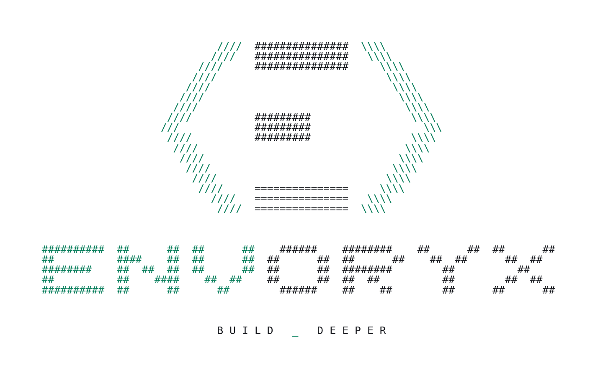
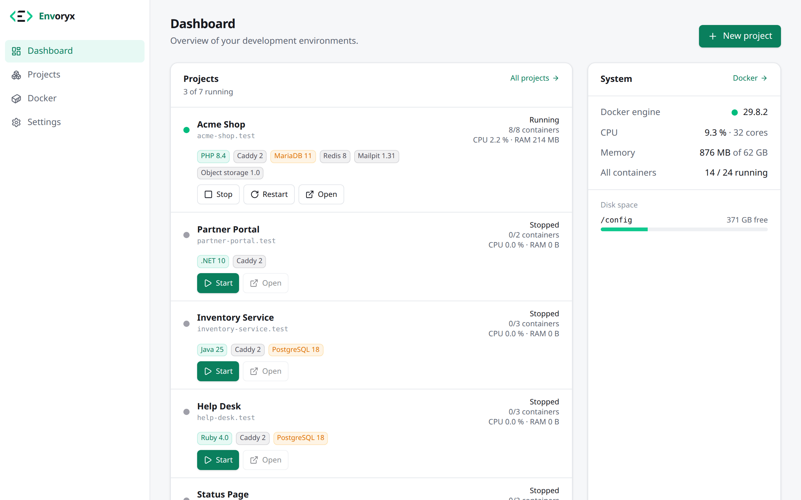

<p align="center">
  <picture>
    <source media="(prefers-color-scheme: dark)" srcset="docs/assets/envoryx-logo-for-dark.png">
    
  </picture>
</p>

<p align="center">
  <strong>Development environments on your own server, set up from a web UI.</strong><br>
  For Linux Docker hosts and Unraid, x86_64 and arm64.
</p>

<p align="center">
  <a href="https://github.com/envoryx/envoryx/actions/workflows/ci.yml"></a>
  <a href="https://github.com/envoryx/envoryx/actions/workflows/codeql.yml"></a>
  <a href="https://github.com/envoryx/envoryx/releases/latest"></a>
  <a href="https://github.com/envoryx/envoryx/pkgs/container/envoryx"></a>
  <a href="https://hub.docker.com/r/envoryx/envoryx"></a>
  <a href="https://github.com/envoryx/envoryx/stargazers"></a>
  <a href="LICENSE"></a>
  
  
</p>

<p align="center">
  <a href="https://envoryx.dev/docs/">Documentation</a> ·
  <a href="https://envoryx.dev/docs/getting-started/installation/">Installation</a> ·
  <a href="CHANGELOG.md">Changelog</a> ·
  <a href="https://github.com/envoryx/envoryx/releases">Releases</a>
</p>

Envoryx is a single container that gives each of your projects its own little stack: a web
server, the runtime it needs (PHP, Node.js, Python, Go, Ruby, Java or .NET), a database and
whatever services you add. You click a project together instead of writing
`docker-compose.yml` files, and it answers at `https://<project>.test` with a trusted
certificate. Your editor connects over SSH, backups run on a schedule, and the whole thing
lives on a home server, a NAS or a cheap VM instead of your laptop.

<picture>
  <source media="(prefers-color-scheme: dark)" srcset="docs/assets/screenshots/dashboard-dark.png">
  
</picture>

## Quick start

All it needs is Docker. This starts Envoryx with the web UI on port 8787:

```sh
mkdir -p ~/envoryx/config ~/envoryx/projects
docker run -d --name envoryx --restart unless-stopped --stop-timeout 90 \
  -p 8787:8787 -p 80:80 -p 443:443 -p 2222:2222 \
  -v /var/run/docker.sock:/var/run/docker.sock \
  -v ~/envoryx/config:/config -v ~/envoryx/projects:/projects \
  -e PUID=$(id -u) -e PGID=$(id -g) -e ENVORYX_SHUTDOWN_GRACE=80s \
  ghcr.io/envoryx/envoryx:latest
```

Open `http://<your-server>:8787`, create the admin account and click **New project**. Ports
80 and 443 are for reaching projects by name, 2222 for your IDE; leave them out if you don't
need that yet.

The [installation guide](https://envoryx.dev/docs/getting-started/installation/) has the
same as a Compose file and explains the options. On **Unraid** there's a
[template](https://envoryx.dev/docs/getting-started/unraid/) with everything filled in.

## What it does

**Projects in a few clicks.** Start from a template (Laravel, Symfony, WordPress, Drupal,
TYPO3, Shopware, Craft CMS, Vite + React, Next.js, Nuxt, Django, Flask, FastAPI, Gin, Echo,
Rails, Sinatra, Spring Boot, Quarkus, ASP.NET Core and more), clone a Git repository, upload
an existing website with its database dump, or start empty. An `envoryx.yml` in the
repository describes the environment, so a fresh clone comes up the same way.

**The runtimes you work with.** Each runs in its own container with the tools around it and,
where it makes sense, a dev server with live reload and a debugger port:

| Runtime | Versions | Comes with |
|---|---|---|
| PHP | 8.2 - 8.5 | Composer, Xdebug, extensions to pick; Caddy, Apache or Nginx in front |
| Node.js | 22, 24, 26 | npm, pnpm, Yarn; dev server with HMR, inspector |
| Python | 3.11 - 3.15 | pip, uv, venv; runserver, uvicorn or gunicorn, debugpy |
| Go | 1.26, 1.27 | air live reload, Delve, gotestsum |
| Ruby | 3.3 - 4.0 | Bundler, Puma, rdbg |
| Java | 17, 21, 25 | Maven, Gradle, Spring Boot DevTools, Quarkus dev mode, JDWP |
| .NET | 8, 10 | `dotnet watch`, `dotnet-ef` |

A runtime can also come from your own image or a Dockerfile in the project.

**Databases and services.** MariaDB, MySQL, PostgreSQL or MongoDB per project (more than one
if you need it, or your own existing server), plus Redis, Memcached, Mailpit, RabbitMQ,
Meilisearch, Typesense, OpenSearch, Ollama and S3-compatible object storage. The connection
details land in the project's environment. Anything else comes in as a small YAML addon.

**Domains and HTTPS.** Every project gets `https://<project>.test` from a local CA you trust
once, or a Let's Encrypt wildcard for your own domain. A built-in proxy handles extra
domains, basic auth, IP rules and redirects, and a project can be shared publicly for a few
hours through a Cloudflare tunnel.

**Working on it.** Live and searchable logs, a browser terminal, one-click actions
(`composer install`, `php artisan migrate`, `npm run build` …), a test runner for PHPUnit,
Pest, npm test scripts, Playwright, Cypress, pytest, go test, RSpec and Rails tests, workers for queues and schedulers, and
cron jobs. Duplicate a project, rename it, or let Envoryx keep a copy per Git branch
(`shop-feature-login.test`) that follows your pushes.

**Your IDE stays local.** PhpStorm, WebStorm, PyCharm, GoLand, RubyMine, IntelliJ, Rider and
VS Code connect over the built-in SSH server for remote interpreters, SFTP and debugging, and
JetBrains Gateway can run its backend next to the project.

**Your data is safe.** Database snapshots before a migration, scheduled project backups,
backups of Envoryx itself, and offsite copies to S3, SFTP or WebDAV, encrypted if you like.
Restoring a project, or a whole instance on a new machine, is a click.

**For a team or a client.** Users with roles (viewer, developer, admin) per project, sign-in
through OpenID Connect, an audit log, notifications to ntfy, Discord, Slack, Telegram or
e-mail, resource limits and health checks per project. The interface speaks English, German,
French, Spanish, Italian, Dutch, Polish, Portuguese, Russian and Ukrainian.

**Scriptable.** A REST API with scoped tokens, a command line (the same binary) and an MCP
server for AI assistants like Claude Code or Cursor.

## How it works

Envoryx keeps what each project should look like in its database (`/config/envoryx.db`) and
makes Docker match it: on every change, at startup and every half minute. Each project gets
its own network and one container per service:

```
Browser ──▶ Envoryx (Go API + React UI, proxy, SSH) ──▶ Docker Engine
                                                         ├── envoryx-<project>        network
                                                         ├── envoryx-<project>-web    Caddy / Apache / Nginx
                                                         ├── envoryx-<project>-php    or -node, -python, -go, -ruby, -java, -dotnet
                                                         ├── envoryx-<project>-database
                                                         └── envoryx-<project>-redis, -mailpit, …
```

Your files live in `/projects/<name>` on the host and are mounted into the containers, owned
by your user. Envoryx only touches Docker resources it labelled itself
(`envoryx.managed=true`), so everything else on the host is left alone. Updating Envoryx
doesn't touch your projects either: their containers keep running while Envoryx is replaced.

## Command line

The binary that runs the server is also the client. On the host:

```sh
docker exec -it envoryx envoryx project list
docker exec -it envoryx envoryx project exec shop -- php artisan migrate --force
```

From any other machine, after `envoryx login --url https://envoryx.example.com`:

```sh
envoryx project create "Shop" --php 8.4 --database mariadb --template laravel --start
envoryx project logs shop --follow
envoryx db snapshot shop --note "before the migration"
envoryx up        # in a clone: envoryx.yml becomes a project
```

See the [command line docs](https://envoryx.dev/docs/automation/cli/) for everything else.

## Documentation

The user documentation, in English and German, is at **[envoryx.dev/docs](https://envoryx.dev/docs/)**.
The reference material lives in this repository:

| Document | What's in it |
|---|---|
| [DEPLOYMENT.md](DEPLOYMENT.md) | every setting and environment variable, Unraid, domains and HTTPS, the API, backups, managed instances |
| [SECURITY.md](SECURITY.md) | the threat model, the Docker socket and how to harden a setup |
| [ARCHITECTURE.md](ARCHITECTURE.md) | design, data model and the project lifecycle |
| [DEVELOPMENT.md](DEVELOPMENT.md) | building, running and testing Envoryx locally |
| [CHANGELOG.md](CHANGELOG.md) | what changed in each release |

## Contributing

Bug reports and ideas are welcome as [issues](https://github.com/envoryx/envoryx/issues).
For code, see [CONTRIBUTING.md](CONTRIBUTING.md); pull requests need a one-time signature of
the [Contributor License Agreement](CLA.md).

## License

Envoryx is free software under the [GNU Affero General Public License v3.0](LICENSE). You may
use it freely, also commercially. If you change it and distribute it, or offer a changed
version as a network service, you publish your changes under the same license. The projects
you run inside Envoryx aren't affected by it.

Copyright (c) 2026 Stefan Mertens
